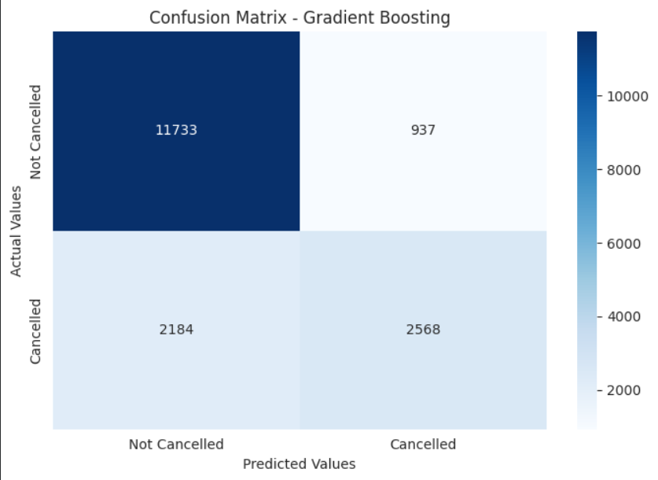
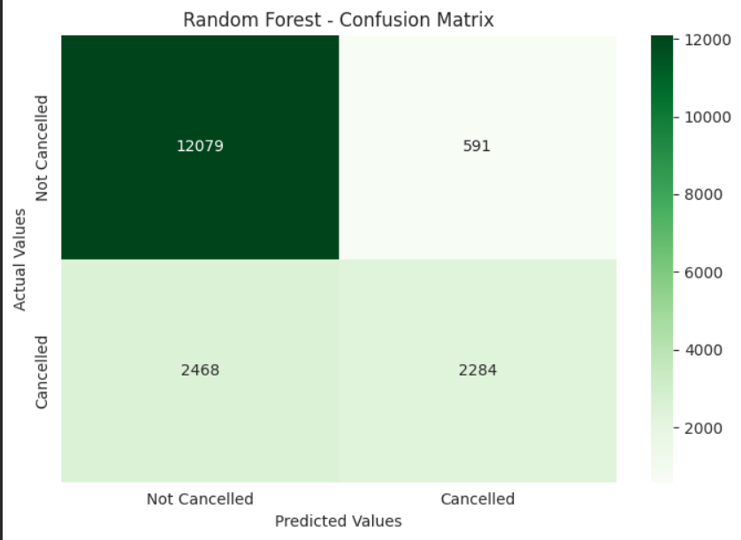
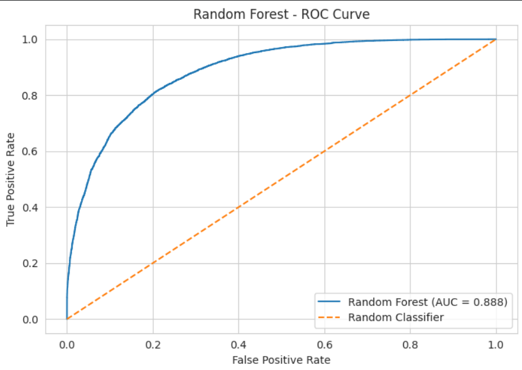
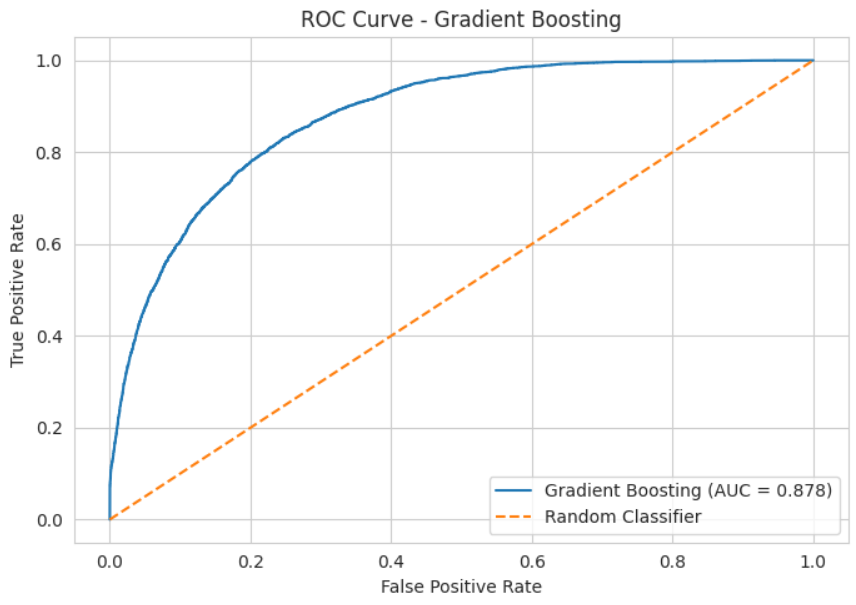
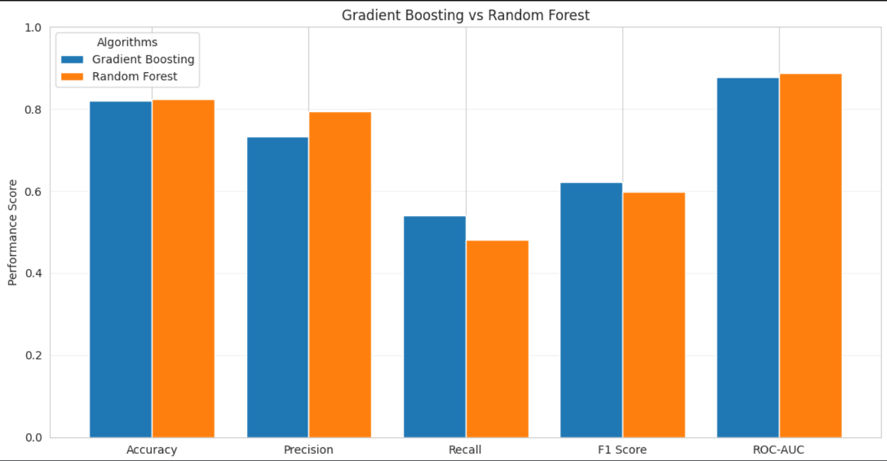

# Hotel Booking Cancellation Prediction

A Machine Learning project that predicts whether a hotel reservation is likely to be cancelled using historical hotel booking data. This project implements and compares two ensemble learning algorithms: **Gradient Boosting Classifier** and **Random Forest Classifier**.

---

## Table of Contents

1. Project Overview
2. Objectives
3. Dataset
4. Technologies Used
5. Project Workflow
6. Data Preprocessing
7. Machine Learning Algorithms
8. Model Evaluation
9. Project Visualizations
10. Sample Predictions
11. How to Run the Project
12. Repository Structure
13. Future Improvements
14. Conclusion

---

## 1. Project Overview

Hotel booking cancellations can affect hotel revenue, room allocation, and operational planning. Predicting potential cancellations can help hotels make better decisions and manage their reservations more effectively.

The objective of this project is to develop machine learning models that analyse historical hotel booking data and predict whether a reservation will be cancelled.

Two classification algorithms, Gradient Boosting and Random Forest, are implemented and evaluated to compare their predictive performance.

**Target Variable: `is_canceled`**

- `0` – Booking Not Cancelled
- `1` – Booking Cancelled

## 2. Objectives

- Analyse hotel booking data and identify relevant patterns.
- Perform data cleaning and preprocessing.
- Conduct Exploratory Data Analysis (EDA).
- Train a Gradient Boosting classification model.
- Train a Random Forest classification model.
- Evaluate both models using standard classification metrics.
- Compare the performance of the two algorithms.
- Perform sample predictions using manually provided booking details.

## 3. Dataset

**Dataset Name:** Hotel Booking Demand

**Source:** Kaggle

**Dataset Link:** https://www.kaggle.com/datasets/jessemostipak/hotel-booking-demand

The dataset contains historical booking records from two types of hotels:

- City Hotel
- Resort Hotel

It includes information such as:

- Lead time
- Arrival date
- Number of adults and children
- Previous cancellations
- Customer type
- Deposit type
- Market segment
- Special requests
- Average daily rate

The dataset is downloaded directly using KaggleHub.

## 4. Technologies Used

| Technology / Library | Purpose |
|---|---|
| Python | Programming language |
| Google Colab | Development environment |
| Pandas | Data manipulation and analysis |
| NumPy | Numerical operations |
| Matplotlib | Data visualization |
| Seaborn | Statistical visualization |
| Scikit-learn | Machine learning and evaluation |
| KaggleHub | Dataset download |

## 5. Project Workflow

The project follows these stages:

1. **Dataset Collection:** Downloaded the Hotel Booking Demand dataset using KaggleHub.
2. **Data Exploration:** Examined dataset dimensions, column names, data types, missing values, duplicate records, and statistical summaries.
3. **Data Cleaning:** Removed duplicate records, handled missing values, and removed selected columns.
4. **Exploratory Data Analysis:** Analysed booking patterns and relationships between different variables.
5. **Feature Selection:** Separated the target variable (`is_canceled`) from the input features.
6. **Data Preprocessing:** Applied numerical imputation and categorical encoding using Scikit-learn pipelines.
7. **Train-Test Split:** Divided the dataset into 80% training data and 20% testing data using stratified sampling.
8. **Model Training:** Trained Gradient Boosting and Random Forest classifiers.
9. **Model Evaluation:** Evaluated both models using accuracy, precision, recall, F1 score, and ROC-AUC.
10. **Sample Prediction:** Provided custom booking details to both trained models and compared their predictions.

## 6. Data Preprocessing

The following preprocessing operations were performed:

- Removed duplicate records.
- Removed `company` and `agent` columns due to substantial missing values.
- Removed `reservation_status` and `reservation_status_date` to prevent data leakage, as these fields are closely related to the final booking outcome.
- Replaced missing numerical values using median imputation.
- Replaced missing categorical values using most-frequent imputation.
- Applied One-Hot Encoding to categorical features.
- Split the dataset into training and testing sets using an 80:20 ratio.

The preprocessing pipeline was fitted on the training data and then applied to the testing data to avoid data leakage.

## 7. Machine Learning Algorithms

### A. Gradient Boosting Classifier

Gradient Boosting is an ensemble learning algorithm that builds multiple decision trees sequentially. Each new tree attempts to correct the errors made by the previous trees.

The predictions of the individual trees are combined to produce the final classification.

### B. Random Forest Classifier

Random Forest is an ensemble learning algorithm that builds multiple decision trees using different samples and feature subsets.

The final classification is determined through majority voting among the individual decision trees.

Both algorithms were trained using the same training dataset and evaluated using the same testing dataset.

## 8. Model Evaluation

Both algorithms were evaluated using five standard classification metrics.

### Performance Comparison

| Evaluation Metric | Gradient Boosting | Random Forest |
|---|---:|---:|
| Accuracy | 82.09% | 82.44% |
| Precision | 73.27% | 79.44% |
| Recall | 54.04% | 48.06% |
| F1 Score | 62.20% | 59.89% |
| ROC-AUC | 87.79% | 88.79% |

### Interpretation of Results

- **Accuracy:** Random Forest achieved slightly higher overall accuracy.
- **Precision:** Random Forest performed better in correctly identifying bookings predicted as cancelled.
- **Recall:** Gradient Boosting identified a greater proportion of actual cancellations.
- **F1 Score:** Gradient Boosting achieved a better balance between precision and recall.
- **ROC-AUC:** Random Forest achieved a slightly higher ROC-AUC score, indicating better overall ranking ability across different classification thresholds.

### Model Comparison Conclusion

Random Forest performed better in accuracy, precision, and ROC-AUC, whereas Gradient Boosting performed better in recall and F1 score.

Therefore, neither algorithm is the absolute winner across all evaluation metrics.

Gradient Boosting may be preferable when identifying a larger proportion of actual cancellations is important, while Random Forest may be preferable when higher precision is the priority.

## 9. Project Visualizations

### Gradient Boosting - Confusion Matrix


### Random Forest - Confusion Matrix


### Random Forest - ROC Curve


### Gradient Boosting - ROC Curve


### Model Performance Comparison


## 10. Sample Predictions

To demonstrate the prediction capabilities of both trained models, a sample hotel booking was manually created and provided as input to both algorithms.

### Sample Booking Details

| Feature | Sample Value |
|---|---|
| Hotel | City Hotel |
| Lead Time | 120 days |
| Adults | 2 |
| Children | 0 |
| Weekend Nights | 1 |
| Week Nights | 3 |
| Previous Cancellations | 1 |
| Special Requests | 2 |
| Deposit Type | No Deposit |
| Customer Type | Transient |

### Prediction Results

| Algorithm | Prediction | Cancellation Probability |
|---|---|---:|
| Gradient Boosting | Cancelled | 91.52% |
| Random Forest | Cancelled | 74.49% |

Both models predicted that the sample booking would be cancelled.

Gradient Boosting assigned a higher estimated cancellation probability than Random Forest for this particular booking.

**Note:** These probabilities are model estimates and do not guarantee the actual outcome of a booking.

## 11. How to Run the Project

1. Download or clone this GitHub repository.
2. Open the `.ipynb` notebook in Google Colab.
3. Run the notebook cells sequentially, starting with the import and dataset download cells.
4. Allow KaggleHub to download the dataset.
5. Execute the data preprocessing and EDA sections.
6. Run the Gradient Boosting and Random Forest training cells.
7. Execute the evaluation and comparison sections.
8. Run the sample prediction section to test both models.

**Note:** An internet connection is required for downloading the dataset through KaggleHub. Configure Kaggle access if your environment requires authentication. Never upload Kaggle credentials or API tokens to GitHub.

## 12. Repository Structure

```text
Hotel-Booking-Cancellation-Prediction/
│
├── Hotel_Booking_Cancellation_Prediction.ipynb
│
├── README.md
│
└── images/
    ├── confusion_matrix_gradient_boost.png
    ├── confusion_matrix_random_forest.png
    ├── roc_curve_gradient_boost.png
    ├── roc_curve_random_forest.png
    └── comparison.png
```

The images folder is optional and should contain the actual visualization images saved from the notebook.

## 13. Future Improvements

The project can be extended through the following improvements:

- Hyperparameter tuning to improve model performance.
- Implementation of additional classification algorithms.
- Class balancing techniques to improve cancellation recall.
- Classification threshold optimization.
- Development of an interactive web application for real-time predictions.
- Deployment of the selected model as a prediction service.

## 14. Conclusion

This project demonstrates how machine learning can be applied to hotel booking data to predict potential reservation cancellations.

Gradient Boosting and Random Forest were successfully implemented, trained, and evaluated. Their performance was compared using multiple evaluation metrics, and both models were tested using manually provided booking details.

The results demonstrate that ensemble learning algorithms can identify useful patterns in historical hotel booking data and provide predictions that may support better reservation management and business planning.

The comparison also highlights the importance of selecting a machine learning model based on the problem's requirements rather than relying on accuracy alone.

---

**Project Category:** Machine Learning | Supervised Learning | Classification

**Programming Language:** Python

**Development Environment:** Google Colab

**Dataset:** Hotel Booking Demand – Kaggle
